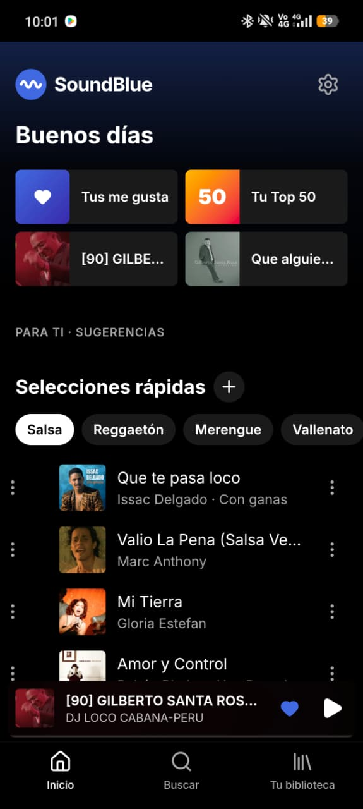
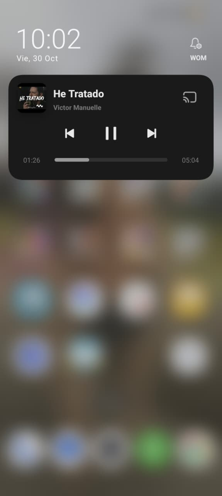

# 🎵 SoundBlue Mobile

Un reproductor de música nativo para Android construido con React, Capacitor y ExoPlayer. Sin anuncios, con soporte en
segundo plano y un widget interactivo.

**[⬇️ Descargar la última versión (SoundBlue.apk)](https://github.com/MikeM4n/soundblue-mobile/releases/latest/download/SoundBlue.apk)** · Android 7.0 o superior

## 📸 Capturas de pantalla

<table>
  <tr>
    <td align="center"><br><b>Inicio</b></td>
    <td align="center"><br><b>Reproductor</b></td>
    <td align="center"><br><b>Letra (karaoke)</b></td>
  </tr>
  <tr>
    <td align="center"><br><b>Widget</b></td>
    <td align="center"><br><b>Notificación</b></td>
    <td></td>
  </tr>
</table>

## ✨ Características

- **Motor nativo (ExoPlayer + NewPipe):** el audio se reproduce con ExoPlayer (Media3) y NewPipe Extractor obtiene el
  enlace directamente, sin el reproductor web de YouTube y sin anuncios. La cola vive en el servicio nativo: precarga la
  siguiente canción y salta sola las que no se pueden reproducir.
- **Reproducción en segundo plano:** sigue sonando con la pantalla apagada o en otra app, con controles en la
  notificación, la pantalla de bloqueo, los audífonos y el reloj. Se pausa al desconectar los audífonos.
- **Widget nativo interactivo (Jetpack Glance):** carátula, canción y ⏮ ⏯ ⏭ ♥ en la pantalla de inicio. Se adapta al
  tamaño (4×1 o más grande), recuerda la última canción y ▶ la vuelve a poner a sonar sin abrir la app.
- **Karaoke:** letra sincronizada (YouTube Music o LRCLib) con la línea que se canta resaltada; al tocar una línea, la
  canción salta a ese momento.
- **Recomendaciones:** «Para ti», «Selecciones rápidas» por género, radios y la Fila Dinámica, que mantiene la cola con al
  menos 10 canciones. La bienvenida precarga tus artistas y géneros para que Inicio abra lleno.
- **Tu biblioteca:** Me gusta, playlists propias e importación de playlists de YouTube.
- **Actualizaciones integradas (in-app updates):** la app avisa cuando hay una versión nueva, la descarga y abre el
  instalador de Android.
- **Firmado de producción:** el APK se compila en modo release (no depurable) y se firma siempre con la misma clave.

## 🧱 Arquitectura

| Capa | Tecnología |
|---|---|
| Interfaz | React 19 + TypeScript, Vite, Tailwind CSS 4 |
| Puente nativo | Capacitor 8, con plugins propios: `NativePlayer`, `NewPipe` y `AppUpdater` |
| Reproductor | Java + Media3 ExoPlayer 1.9 en un `MediaSessionService` (`PlaybackService`) |
| Extracción de audio | NewPipe Extractor 0.26.5 |
| Widget | Kotlin + Jetpack Glance 1.2 |
| Catálogo | YouTube Music (API interna) a través de un intermediario en Cloudflare Workers (`worker/ytm-proxy.js`) |

**Cómo encaja:** la interfaz en React decide qué suena y le pasa la cola a `PlaybackService` con el plugin
`NativePlayer`. El servicio obtiene el audio con NewPipe, lo reproduce con ExoPlayer y publica una `MediaSession`, que es
la misma que usan la notificación, los audífonos y el widget. Los cambios de canción y de estado vuelven a la interfaz
como eventos.

```
src/                                    Interfaz (React)
  player/                               Motor de reproducción y puente con el reproductor nativo
  lib/apkUpdate.ts                      Revisión de versiones nuevas
android/app/src/main/java/com/soundblue/mobile/
  PlaybackService.java                  Reproductor nativo (ExoPlayer + MediaSession)
  PlaybackPlugin.java, NewPipePlugin.java, UpdatePlugin.java
  widget/                               Widget (Jetpack Glance)
scripts/android-apk.mjs                 Compilación del APK
worker/ytm-proxy.js                     Intermediario del catálogo
version.json                            Última versión publicada (la lee la app)
```

## 📲 Instalación y actualizaciones

### Instalar
1. Descarga `SoundBlue.apk` desde la [última versión publicada](https://github.com/MikeM4n/soundblue-mobile/releases/latest).
2. Ábrelo en el teléfono. La primera vez, Android pide permitir «Instalar apps desconocidas» para el navegador o el
   administrador de archivos con el que lo abres.

### Actualizaciones automáticas
La app se actualiza sola a partir de [`version.json`](version.json), en la raíz de este repositorio:

```json
{
  "versionCode": 10702,
  "versionName": "1.7.2",
  "apkUrl": "https://github.com/MikeM4n/soundblue-mobile/releases/download/v1.7.2/SoundBlue.apk",
  "changelog": "…"
}
```

1. Al abrirse, la app lee ese archivo desde GitHub y compara su `versionCode` con el de la versión instalada.
2. Si es mayor, aparece el aviso «Nueva versión de SoundBlue disponible. ¿Quieres actualizar?».
3. Al aceptar, el plugin `AppUpdater` descarga el APK con el `DownloadManager` de Android, mostrando el progreso, y abre
   el instalador. Android solo lo instala si está firmado con la misma clave que la versión instalada.

## 🛠️ Para desarrolladores

### Requisitos
- Node.js 22 o más reciente.
- JDK 21 y Android SDK 36. El script usa `JAVA_HOME` y `ANDROID_HOME`, o los encuentra en
  `%LOCALAPPDATA%\SoundBlueAndroidBuild` si no están definidos.
- Un archivo `.env` con la dirección del intermediario del catálogo (ver [`.env.example`](.env.example)).

### Compilar
```bash
npm install
npm run apk      # deja SoundBlue.apk en la raíz del proyecto
```
`npm run apk` compila la interfaz, la copia limpia al proyecto de Android, comprueba que esté completa y genera el APK de
producción firmado.

### Publicar una versión nueva
1. Sube la versión en `package.json`. De ella salen `versionName` y `versionCode` (por ejemplo, 1.7.3 → 10703).
2. Ejecuta `npm run apk`.
3. En GitHub, crea el release `v1.7.3` y adjunta `SoundBlue.apk` con ese nombre exacto.
4. Después de publicar el release, actualiza `version.json` y súbelo a `main`. Si se sube antes, la descarga falla.
   GitHub puede tardar hasta 5 minutos en mostrar el archivo nuevo.

## ⚠️ Aviso

SoundBlue es un proyecto personal, sin relación con YouTube ni con Google. Usa APIs no oficiales de YouTube Music y
NewPipe Extractor, que pueden cambiar sin aviso.
